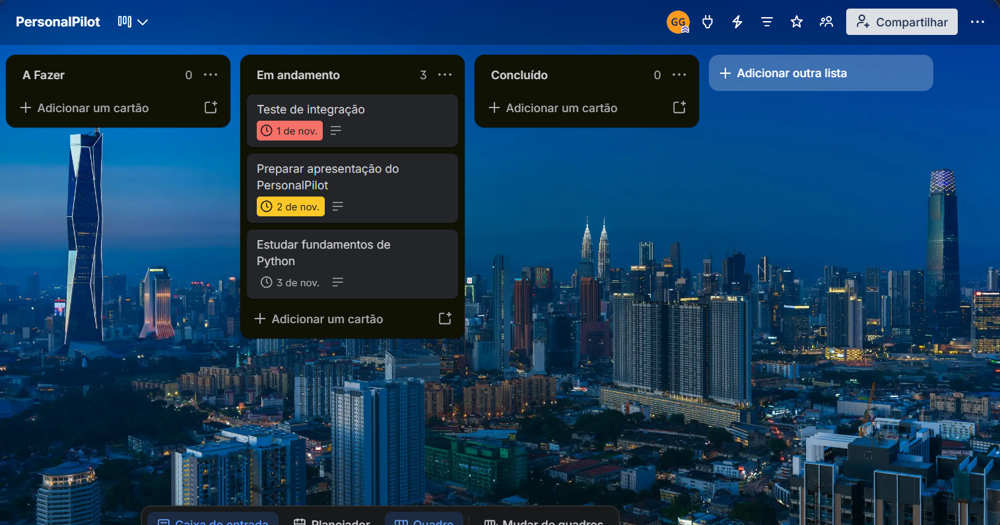
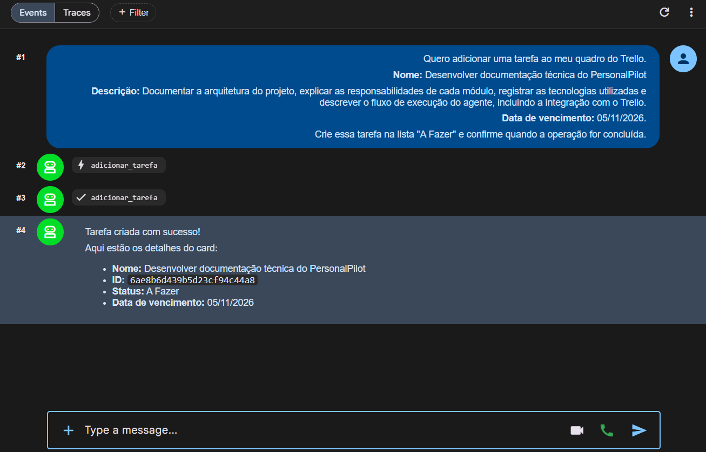
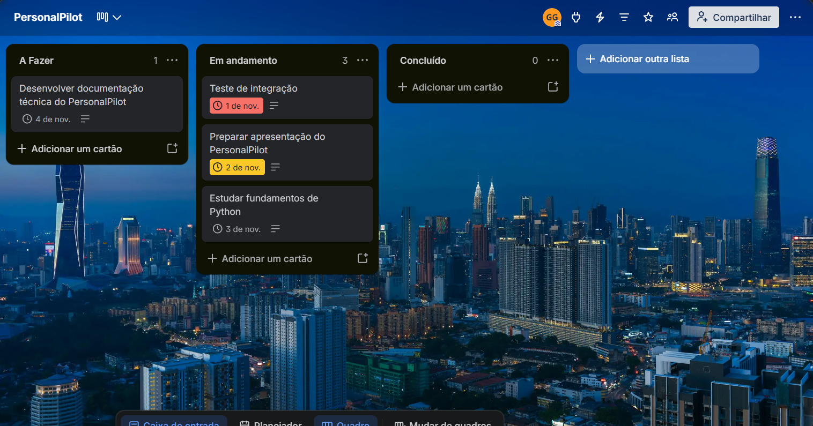
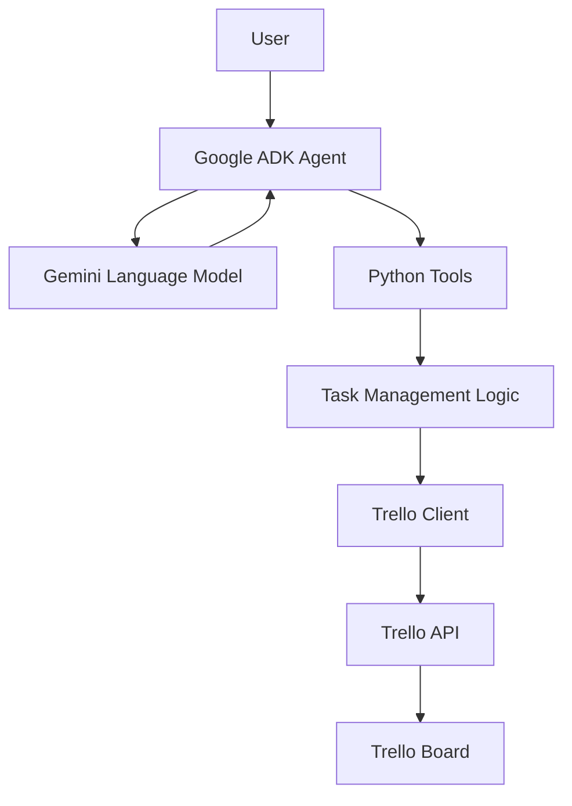
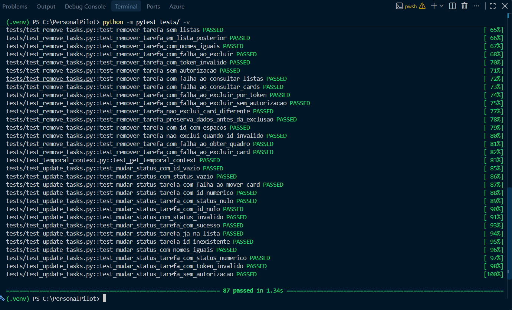
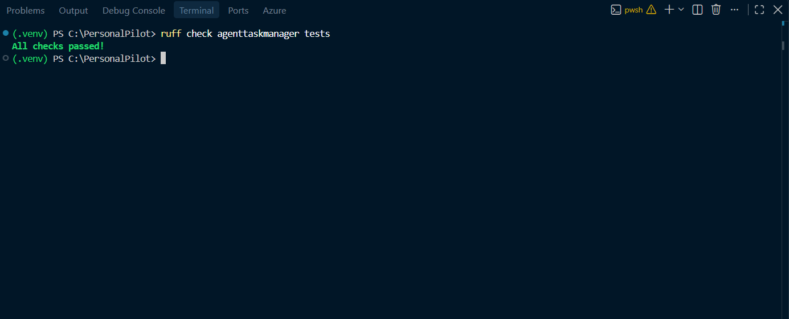

# PersonalPilot

An AI-powered task management agent built with Python, Google ADK, Gemini, and the Trello API.

PersonalPilot allows users to manage their daily tasks through natural language conversations. It interprets user requests and interacts with Trello to create, retrieve, edit, update, and delete task cards.

The project explores the development of AI agents capable of connecting natural language interactions with practical operations in external services.

## 2. Problem & Solution

### The Problem

Managing daily tasks often involves manually creating cards, updating information, tracking progress, and keeping task boards organized. These repetitive operations can make task management less efficient.

### The Solution

PersonalPilot provides a conversational interface for managing tasks through an AI agent.

Instead of manually performing each operation in Trello, users can interact with the agent using natural language. The agent interprets their requests and invokes dedicated Python tools to perform the corresponding operations through the Trello API.

This approach combines language model capabilities with structured application logic, allowing users to manage their tasks through a simpler and more intuitive workflow.

## 3. Features

PersonalPilot supports the following task management operations:

### Task Creation
- Create Trello cards through natural language requests.
- Set task names and descriptions.
- Optionally define due dates.
- Automatically place new tasks in the **To Do** list.

### Task Retrieval
- Retrieve all tasks from the configured Trello board.
- Filter tasks by status:
  - To Do
  - In Progress
  - Completed
- Return task details, including IDs, names, descriptions, due dates, and current status.

### Task Editing
- Update task names.
- Modify task descriptions.
- Change or remove due dates.
- Preserve fields that were not explicitly requested for modification.

### Task Status Management
- Move tasks between the configured Trello lists:
  - To Do
  - In Progress
  - Completed
-

## 4. Demonstration

This section demonstrates PersonalPilot performing a task creation operation through its conversational interface and the Trello API.

The demonstration follows the complete workflow, from the initial state of the Trello board to the successful creation of a new task.

### Step 1 — Initial Trello Board

The Trello board before the operation, showing the initial state of the workflow lists.



### Step 2 — Agent Interaction

The user submits a natural language request through the Google ADK Web interface.

PersonalPilot interprets the request, invokes the `adicionar_tarefa` Python tool, and returns a confirmation containing the created task's details.



### Step 3 — Result in Trello

The Trello board after the operation, showing the newly created task in the **A Fazer** list.



### Demonstrated Workflow

This demonstration illustrates how PersonalPilot connects natural language interaction with practical task management operations.

The agent interprets the user's request, the Python tool executes the operation, and the resulting changes are reflected in the external Trello board.

## 5. Architecture

PersonalPilot follows a modular architecture that separates AI agent orchestration, application logic, configuration, and external service integration.

The Google ADK agent acts as the interaction and orchestration layer, while dedicated Python tools handle task management operations and communicate with the Trello API.

### 5.1. Architecture Overview

The application is organized around the following components:



### 5.2. Execution Flow

A typical interaction follows these steps:

1. The user submits a task management request using natural language.
2. The Google ADK agent receives the request and uses Gemini to interpret the user's intent.
3. The agent selects the appropriate Python tool based on its instructions and the requested operation.
4. The tool validates the input and executes the corresponding business logic.
5. The Trello client communicates with the Trello API to perform the requested operation.
6. The result is returned to the agent, which communicates the outcome to the user.

### 5.3. Component Responsibilities

**AI Agent Layer**

The root agent, configured in `agent.py`, defines the model, instructions, and available tools.

Its behavioral instructions are maintained separately in `prompts.py`, allowing the agent's operational rules to evolve independently from the application logic.

**Application Logic Layer**

The functions implemented in `tools/tasks.py` handle task management operations, including:

- Task creation and retrieval.
- Task editing and status updates.
- Task deletion.
- Input validation.
- Error handling.

This layer also enforces application rules, keeping task operations separate from the language model's interpretation.

**Integration Layer**

The `tools/trello.py` module centralizes the creation of the authenticated Trello client.

This avoids duplicating connection configuration across task management functions and provides a single integration point for Trello communication.

**Configuration Layer**

The `config.py` module loads and validates the environment variables required by the application, including API credentials and Trello board and list settings.

### 5.4. Tool Orchestration

PersonalPilot exposes dedicated Python functions as tools that the Google ADK agent can invoke according to the user's requests.

The agent determines which operation is appropriate, while the Python functions remain responsible for executing the actual operations and enforcing application-level validations.

This separation allows the language model to handle natural language interpretation without directly managing Trello API requests or implementing task management logic.

## 6. Technologies

PersonalPilot is built with the following technologies:

| Technology | Purpose |
|---|---|
| **Python 3.12** | Main programming language. |
| **Google ADK** | Agent development framework and tool orchestration. |
| **Google Gemini** | Language model responsible for interpreting user requests and coordinating task operations. |
| **Trello API** | External service used for task storage and management. |
| **py-trello** | Python library for interacting with the Trello API. |
| **python-dotenv** | Environment variable and configuration management. |
| **pytest** | Automated testing framework. |
| **pytest-mock** | Mocking dependencies during unit tests. |
| **Ruff** | Python linting and code quality checks. |

### Development Environment

- Python virtual environment (`venv`).
- PowerShell.
- Visual Studio Code.

## 7. Project Structure

```text
PersonalPilot/
├── agenttaskmanager/
│   ├── __init__.py
│   ├── agent.py
│   ├── prompts.py
│   ├── config.py
│   └── tools/
│       ├── __init__.py
│       ├── tasks.py
│       └── trello.py
├── tests/
│   ├── test_add_tasks.py
│   ├── test_list_tasks.py
│   ├── test_edit_tasks.py
│   ├── test_update_tasks.py
│   ├── test_remove_tasks.py
│   └── test_temporal_context.py
├── .env.example
├── .gitignore
├── README.md
└── requirements.txt
```

### Main Components

**`agenttaskmanager/`**

Contains the main application code.

- `agent.py`: Defines and configures the root agent, including its model, instructions, and available tools.
- `prompts.py`: Contains the agent's behavioral instructions and operational rules.
- `config.py`: Loads and validates environment variables required by the application.
- `tools/tasks.py`: Implements task management operations, input validation, and error handling.
- `tools/trello.py`: Centralizes the creation of the authenticated Trello client.

**`tests/`**

Contains automated tests organized by functionality.

- `test_add_tasks.py`: Task creation tests.
- `test_list_tasks.py`: Task retrieval and filtering tests.
- `test_edit_tasks.py`: Task editing tests.
- `test_update_tasks.py`: Task status update tests.
- `test_remove_tasks.py`: Task deletion tests.
- `test_temporal_context.py`: Date and time context tests.

**Configuration Files**

- `.env.example`: Template containing the required environment variables.
- `.gitignore`: Defines files and directories excluded from version control.
- `requirements.txt`: Lists the project's Python dependencies.
- `README.md`: Project documentation.

## 8. Configuration & Installation

### Prerequisites

Before installing PersonalPilot, make sure you have:

- Python 3.12
- Git
- A Trello account and API credentials.
- A Google AI Studio API key with access to the Gemini API.

### 1. Clone the Repository

```bash
git clone https://github.com/YOUR_USERNAME/PersonalPilot.git
cd PersonalPilot
```

### 2. Create a Virtual Environment

```bash
python -m venv .venv
```

Activate the virtual environment:

**Windows (PowerShell):**

```powershell
.\.venv\Scripts\Activate.ps1
```

**Linux / macOS:**

```bash
source .venv/bin/activate
```

### 3. Install Dependencies

```bash
python -m pip install --upgrade pip

## 9. Running the Agent

PersonalPilot uses Google ADK Web to provide an interactive interface for communicating with the agent.

### 1. Start the ADK Web Interface

From the project root directory, with the virtual environment activated, run:

```bash
adk web
```

### 2. Access the Interface

After starting the server, the terminal will display the local address where the ADK Web interface is available.

Open the displayed URL in your browser.

### 3. Select the Agent

In the ADK Web interface, select `agenttaskmanager` as the agent directory.

The `personal_pilot` agent will be loaded and ready to receive instructions.

### 4. Start a Conversation

The agent begins by retrieving the current date and asking which tasks you would like to organize.

You can then interact with it using natural language to create, retrieve, edit, update, and delete tasks.

### 5. Stop the Server

To stop the local ADK Web server, return to the terminal and press:

```text
Ctrl + C
```

## 10. Usage Examples

The following examples illustrate how to interact with PersonalPilot through natural language.

### 1. Creating Tasks

**User:**
> Add a task called "Study Python" with the description "Review object-oriented programming concepts" and a due date of November 5, 2026.

**PersonalPilot:**
> Task "Study Python" was successfully created in the To Do list.

### 2. Retrieving Tasks

**User:**
> Show me all my tasks.

**PersonalPilot:**
> Here are your tasks, organized by their current status:
> - Study Python — To Do
> - Review project documentation — In Progress
> - Complete database exercises — Completed

You can also request tasks filtered by status:

**User:**
> Show me only my tasks that are in progress.

### 3. Editing Tasks

**User:**
> Change the description of "Study Python" to "Review classes, inheritance, and polymorphism."

**PersonalPilot:**
> The description of "Study Python" was successfully updated.

You can also modify task names and due dates, or remove an existing due date.

### 4. Updating Task Status

**User:**
> Move "Study Python" to In Progress.

**PersonalPilot:**
> Task "Study Python" was successfully moved to In Progress.

### 5. Deleting Tasks

**User:**
> Delete the task "Review project documentation".

**PersonalPilot:**
> I found the task "Review project documentation" (ID: `example_card_id`). Are you sure you want to permanently delete it?

**User:**
> Yes, confirm deletion.

**PersonalPilot:**
> Task "Review project documentation" was successfully deleted.

### 6. Handling Ambiguous Requests

When multiple tasks have the same name, PersonalPilot requests clarification instead of choosing one automatically.

**User:**
> Edit "Study Python".

**PersonalPilot:**
> I found multiple tasks named "Study Python". Please identify which one you want to edit.

The agent presents the available task details and asks the user to specify the correct task.

## 11. Testing & Quality

PersonalPilot incorporates automated testing and static code analysis to improve reliability, maintainability, and consistency.

The testing strategy focuses on validating individual task management operations, input handling, expected behavior, and error scenarios.

### Testing Strategy

The automated test suite is organized by functionality, with dedicated test modules for task creation, retrieval, editing, status updates, deletion, and temporal context.

Tests cover:

- Successful operations and expected results.
- Input validation and invalid parameters.
- Missing or ambiguous task references.
- Edge cases and unexpected inputs.
- Simulated Trello API failures, including authorization and connectivity errors.

### Automated Tests

The complete test suite was executed using Pytest, with all 87 tests passing successfully.



### Code Quality & Linting

Ruff is used to analyze the Python codebase and identify potential issues related to code quality, style, and consistency.

The project passed the Ruff analysis without reported issues.



## 12. Security & Behavior

PersonalPilot incorporates security measures and behavioral constraints to ensure that task management operations are performed consistently and that sensitive configuration data is protected.

### Credential Management

- API credentials are stored in environment variables through a local `.env` file.
- The `.env` file is excluded from version control.
- A `.env.example` file provides a reference for the required configuration variables without exposing actual credentials.
- Required environment variables are validated during application configuration.

### Input Validation

Task management tools validate incoming parameters before performing operations.

Validation includes:

- Required fields and non-empty values.
- Valid task identifiers.
- Valid date formats.
- Supported task status values.
- Task and board identification.

Status inputs are normalized to handle differences in capitalization, whitespace, and accented characters.

### Controlled Operations

The agent follows specific behavioral rules when executing task management operations:

- Ambiguous task references require clarification before an operation is performed.
- Tasks are identified using their unique Trello card IDs to avoid unintended modifications.
- Only explicitly requested fields are modified during task editing.
- Existing task information is preserved when a field is not included in an editing request.

### Deletion Confirmation

Task deletion is a permanent operation and requires explicit user confirmation.

Before invoking the deletion tool, the agent must:

1. Identify the target task.
2. Present its name and unique ID.
3. Request explicit confirmation.
4. Execute the deletion only after receiving confirmation.

The Python tool handles the actual deletion, while the agent's instructions enforce the confirmation workflow.

### Error Handling

Trello-related errors are handled through a centralized error-handling mechanism.

The application distinguishes between validation errors, authentication failures, authorization errors, and communication failures.

Errors are returned to the agent with appropriate messages, allowing it to communicate unsuccessful operations without falsely reporting success.

## 13. Technical Decisions

The development of PersonalPilot involved several technical decisions aimed at keeping the architecture modular, the task management logic reliable, and the agent's responsibilities clearly defined.

### Agent Framework and Language Model

Google ADK was selected as the agent development framework, with Google Gemini serving as the language model.

This combination provides the orchestration layer responsible for interpreting natural language requests, determining which tools to invoke, and communicating results to the user.

### Separation of Responsibilities

The project separates language model reasoning from application logic.

The agent interprets user intent and selects the appropriate Python tool, while the tools handle validation, task identification, business rules, and interactions with Trello.

This separation keeps external service operations within deterministic application code rather than relying on the language model to execute them directly.

### Trello Integration

The `py-trello` library was adopted to interact with the Trello API.

The Trello client is centralized in a dedicated module, avoiding duplicated connection configuration across task management operations.

This approach simplifies configuration and keeps external service integration separate from the core task management logic.

### Single-Board Scope

PersonalPilot was designed to operate on one configured Trello board.

This was an intentional scope decision to keep the agent focused on personal task management rather than introducing additional complexity related to board selection and multi-board operations.

The board name and workflow lists are configurable through environment variables.

### Task Identification

Trello card IDs are used to identify tasks during editing, status updates, and deletion.

Task names alone are not sufficient identifiers because different cards may share the same name.

When a request refers to multiple matching tasks, the agent must ask the user to clarify which task they intend to modify.

### Status Normalization

Status inputs are normalized before being matched against the configured Trello lists.

This allows the application to handle differences in capitalization, whitespace, and accented characters, making natural language interactions more flexible without compromising the underlying status values.

### Controlled Task Updates

Task editing was designed to modify only the fields explicitly provided by the user.

Omitted fields preserve their existing values, while explicitly empty descriptions or due dates can be used to clear those fields.

This behavior prevents unintended changes to existing task information.

### Deletion Safety

Task deletion is permanent, so an explicit confirmation workflow was added to the agent's instructions.

The agent must identify the task, present its name and ID, and wait for confirmation before invoking the deletion tool.

This decision adds a safeguard against accidental deletion during conversational interactions.

### Testing and Error Handling

Pytest was selected for automated testing, while Ruff provides static code analysis and consistency checks.

The application also uses centralized handling for Trello-related errors, allowing task management tools to return consistent responses when operations fail.

These decisions support a more maintainable codebase and help ensure that the agent communicates operation results accurately.

## 14. Known Limitations

PersonalPilot was developed with a focused scope centered on managing tasks through a single Trello board. Although the current implementation supports the main task management operations, some limitations remain.

### Single-Board Operation

The agent operates on one Trello board configured through environment variables.

It does not currently support selecting or switching between multiple boards during a conversation.

### Fixed Workflow Structure

The application expects three existing Trello lists:

- A Fazer
- Em andamento
- Concluído

Creating, renaming, or deleting workflow lists through the agent is not currently supported.

### Trello Dependency

Task data is stored and managed directly through Trello.

Consequently, task management operations depend on Trello API availability, valid credentials, and access to the configured board.

### Conversational Interface

The current interaction model is designed around the Google ADK development interface.

A dedicated messaging platform integration, such as WhatsApp, is not currently included.

### Language Model Dependency

Natural language interpretation and tool orchestration depend on the configured Google Gemini model.

Model availability, API limits, and service interruptions may affect the agent's ability to process requests.

## 15. Future Improvements

PersonalPilot has a modular architecture that allows future enhancements without requiring a complete redesign of its core task management logic.

Potential improvements include:

### WhatsApp Integration

Integrate PersonalPilot with WhatsApp to provide a more accessible conversational interface.

The existing agent and Python tools could remain responsible for interpreting requests and executing task operations, while a messaging integration would act as an additional communication layer between users and the agent.

### Multi-Board Support

Extend the application to support multiple Trello boards, allowing users to select which board they want to manage.

### Configurable Workflow Lists

Allow users to configure workflow stages and manage additional Trello lists through the agent.

### Improved Conversation Management

Introduce persistent conversation history to support more continuous interactions and preserve relevant context across sessions.

### Additional Task Management Capabilities

Explore further functionality, such as:

- Task prioritization.
- Recurring tasks.
- Task categorization and labels.
- Filtering by due date and priority.
- Task summaries and progress reports.

These improvements represent possible directions for expanding PersonalPilot while preserving its existing separation between agent orchestration, application logic, and external service integration.

## 16. Author

Developed as part of the DXC Technology bootcamp in partnership with DIO (Digital Innovation One).

PersonalPilot is an educational project focused on exploring AI agent development, Python application architecture, and integration with external services through APIs.

### License

No license has been specified for this project yet.