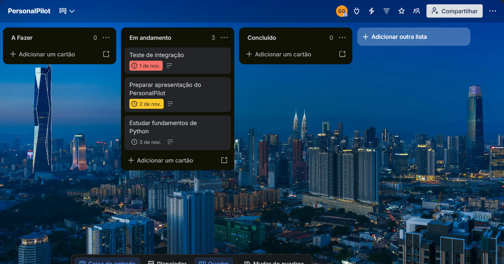
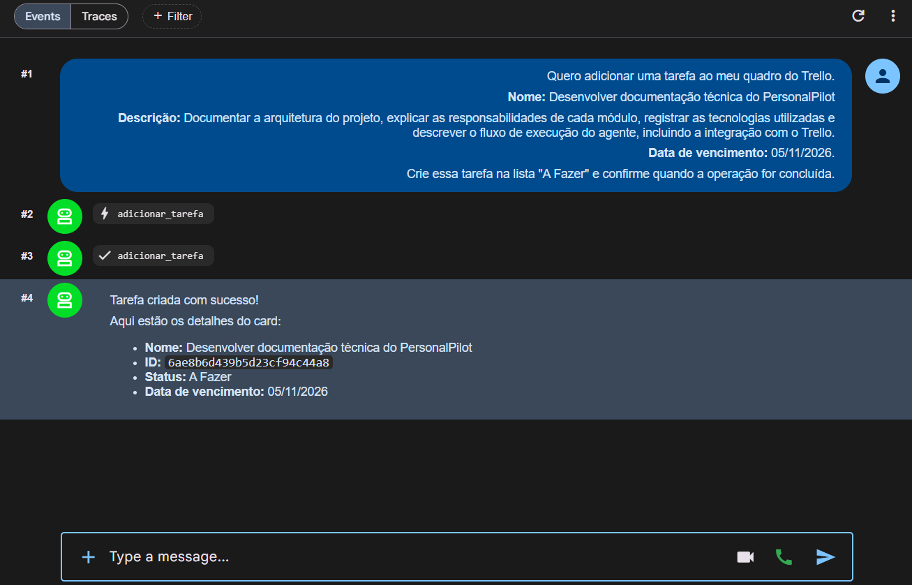
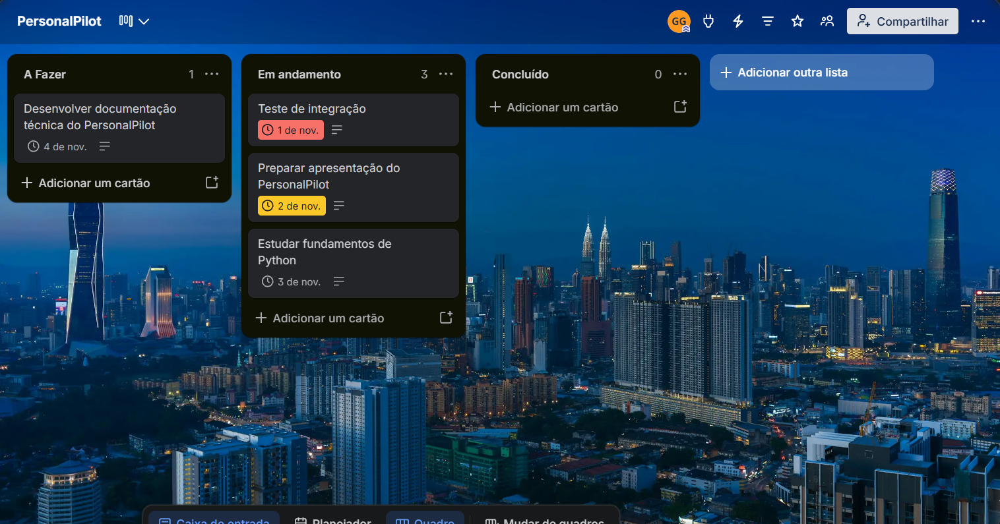
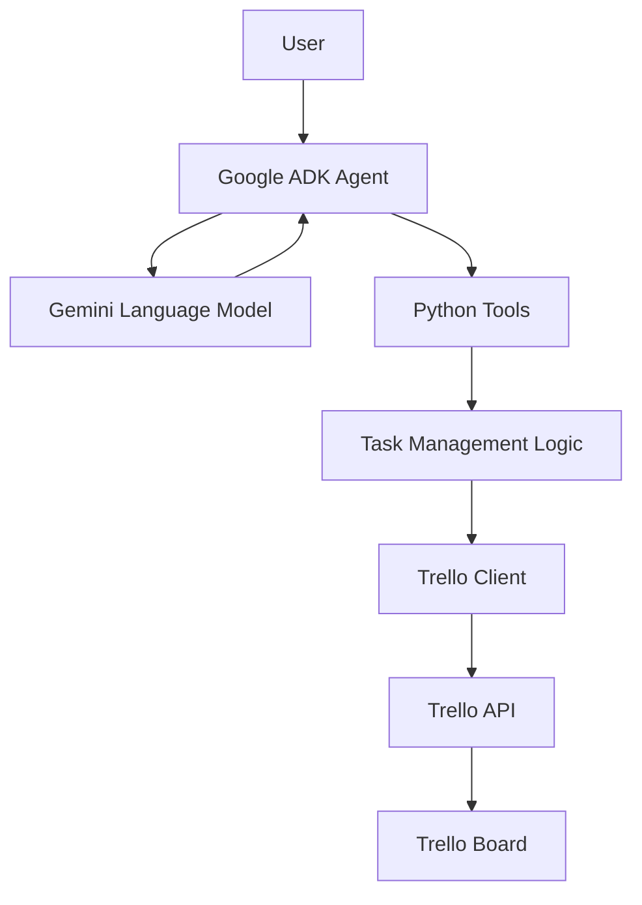
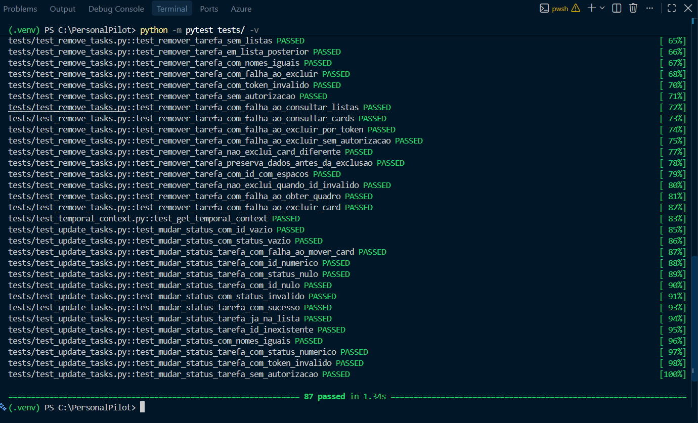
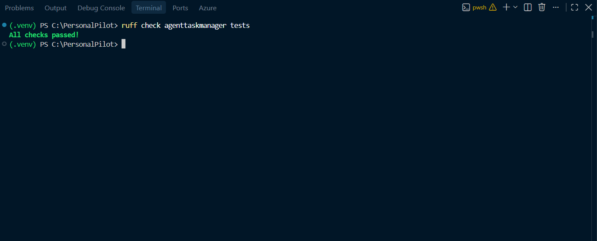

# PersonalPilot

Um agente de gerenciamento de tarefas com inteligência artificial, desenvolvido com Python, Google ADK, Gemini e a API do Trello.

O PersonalPilot permite que os usuários gerenciem suas tarefas diárias por meio de conversas em linguagem natural. Ele interpreta as solicitações dos usuários e interage com o Trello para criar, consultar, editar, atualizar e excluir cards de tarefas.

O projeto explora o desenvolvimento de agentes de IA capazes de conectar interações em linguagem natural a operações práticas em serviços externos.

## 2. Problema e Solução

### O Problema

O gerenciamento de tarefas diárias frequentemente envolve a criação manual de cards, a atualização de informações, o acompanhamento do progresso e a organização de quadros de tarefas. Essas operações repetitivas podem tornar o gerenciamento de tarefas menos eficiente.

### A Solução

O PersonalPilot oferece uma interface conversacional para o gerenciamento de tarefas por meio de um agente de IA.

Em vez de realizar manualmente cada operação no Trello, os usuários podem interagir com o agente utilizando linguagem natural. O agente interpreta suas solicitações e aciona ferramentas Python específicas para executar as operações correspondentes por meio da API do Trello.

Essa abordagem combina as capacidades de um modelo de linguagem com uma lógica de aplicação estruturada, permitindo que os usuários gerenciem suas tarefas por meio de um fluxo de trabalho mais simples e intuitivo.

## 3. Funcionalidades

O PersonalPilot oferece suporte às seguintes operações de gerenciamento de tarefas:

### Criação de Tarefas

- Criar cards no Trello por meio de solicitações em linguagem natural.
- Definir nomes e descrições para as tarefas.
- Definir datas de vencimento opcionalmente.
- Adicionar automaticamente novas tarefas à lista **A Fazer**.

### Consulta de Tarefas

- Consultar todas as tarefas do quadro Trello configurado.
- Filtrar tarefas por status:
  - A Fazer
  - Em andamento
  - Concluído
- Retornar detalhes das tarefas, incluindo IDs, nomes, descrições, datas de vencimento e status atual.

### Edição de Tarefas

- Atualizar nomes das tarefas.
- Modificar descrições das tarefas.
- Alterar ou remover datas de vencimento.
- Preservar os campos que não foram explicitamente indicados para modificação.

### Gerenciamento de Status das Tarefas

- Mover tarefas entre as listas configuradas no Trello:
  - A Fazer
  - Em andamento
  - Concluído

### Remoção de Tarefas

- Excluir tarefas do quadro Trello configurado.
- Identificar tarefas utilizando seus IDs exclusivos de card.
- Exigir confirmação explícita do usuário antes da exclusão.
- Retornar os detalhes da tarefa excluída após a remoção bem-sucedida.

### Funcionalidades Adicionais

- Interpretar solicitações de gerenciamento de tarefas expressas em linguagem natural.
- Lidar com referências ambíguas a tarefas, solicitando esclarecimentos ao usuário.
- Normalizar entradas de status, incluindo diferenças de capitalização, espaços em branco e caracteres acentuados.
- Validar os dados de entrada antes de executar as operações.
- Tratar erros da API do Trello e retornar mensagens apropriadas ao agente.
- Oferecer suporte a campos opcionais nas tarefas, preservando as informações existentes quando nenhuma modificação é solicitada.

## 4. Demonstração

Esta seção demonstra o PersonalPilot executando uma operação de criação de tarefa por meio de sua interface conversacional e da API do Trello.

A demonstração acompanha o fluxo completo, desde o estado inicial do quadro Trello até a criação bem-sucedida de uma nova tarefa.

### Etapa 1 — Quadro Trello Inicial

O quadro Trello antes da operação, mostrando o estado inicial das listas do fluxo de trabalho.



### Etapa 2 — Interação com o Agente

O usuário envia uma solicitação em linguagem natural por meio da interface Google ADK Web.

O PersonalPilot interpreta a solicitação, aciona a ferramenta Python `adicionar_tarefa` e retorna uma confirmação contendo os detalhes da tarefa criada.



### Etapa 3 — Resultado no Trello

O quadro Trello após a operação, mostrando a nova tarefa criada na lista **A Fazer**.



### Fluxo de Trabalho Demonstrado

Esta demonstração ilustra como o PersonalPilot conecta interações em linguagem natural a operações práticas de gerenciamento de tarefas.

O agente interpreta a solicitação do usuário, a ferramenta Python executa a operação e as alterações resultantes são refletidas no quadro Trello externo.

## 5. Arquitetura

O PersonalPilot segue uma arquitetura modular que separa a orquestração do agente de IA, a lógica da aplicação, a configuração e a integração com serviços externos.

O agente Google ADK atua como camada de interação e orquestração, enquanto ferramentas Python específicas executam as operações de gerenciamento de tarefas e se comunicam com a API do Trello.

### 5.1. Visão Geral da Arquitetura

A aplicação está organizada em torno dos seguintes componentes:



### 5.2. Fluxo de Execução

Uma interação típica segue estas etapas:

1. O usuário envia uma solicitação de gerenciamento de tarefas utilizando linguagem natural.
2. O agente Google ADK recebe a solicitação e utiliza o Gemini para interpretar a intenção do usuário.
3. O agente seleciona a ferramenta Python apropriada com base em suas instruções e na operação solicitada.
4. A ferramenta valida os dados de entrada e executa a lógica de negócio correspondente.
5. O cliente Trello se comunica com a API do Trello para realizar a operação solicitada.
6. O resultado é retornado ao agente, que comunica o resultado ao usuário.

### 5.3. Responsabilidades dos Componentes

**Camada do Agente de IA**

O agente principal (*root agent*), configurado em `agent.py`, define o modelo, as instruções e as ferramentas disponíveis.

Suas instruções comportamentais são mantidas separadamente em `prompts.py`, permitindo que as regras operacionais do agente evoluam independentemente da lógica da aplicação.

**Camada de Lógica da Aplicação**

As funções implementadas em `tools/tasks.py` são responsáveis pelas operações de gerenciamento de tarefas, incluindo:

- Criação e consulta de tarefas.
- Edição de tarefas e atualização de status.
- Exclusão de tarefas.
- Validação de dados de entrada.
- Tratamento de erros.

Essa camada também aplica as regras da aplicação, mantendo as operações de gerenciamento de tarefas separadas da interpretação realizada pelo modelo de linguagem.

**Camada de Integração**

O módulo `tools/trello.py` centraliza a criação do cliente autenticado do Trello.

Isso evita a duplicação das configurações de conexão entre as funções de gerenciamento de tarefas e fornece um único ponto de integração para a comunicação com o Trello.

**Camada de Configuração**

O módulo `config.py` carrega e valida as variáveis de ambiente necessárias para a aplicação, incluindo credenciais de API e configurações do quadro e das listas do Trello.

### 5.4. Orquestração de Ferramentas

O PersonalPilot disponibiliza funções Python específicas como ferramentas que o agente Google ADK pode invocar de acordo com as solicitações do usuário.

O agente determina qual operação é apropriada, enquanto as funções Python permanecem responsáveis pela execução das operações propriamente ditas e pela aplicação das validações no nível da aplicação.

Essa separação permite que o modelo de linguagem interprete solicitações em linguagem natural sem gerenciar diretamente as requisições à API do Trello ou implementar a lógica de gerenciamento de tarefas.

## 6. Tecnologias

O PersonalPilot foi desenvolvido utilizando as seguintes tecnologias:

| Tecnologia | Finalidade |
|---|---|
| **Python 3.12** | Linguagem de programação principal. |
| **Google ADK** | Framework para desenvolvimento de agentes e orquestração de ferramentas. |
| **Google Gemini** | Modelo de linguagem responsável por interpretar as solicitações dos usuários e coordenar as operações de gerenciamento de tarefas. |
| **Trello API** | Serviço externo utilizado para armazenamento e gerenciamento de tarefas. |
| **py-trello** | Biblioteca Python para interação com a API do Trello. |
| **python-dotenv** | Gerenciamento de variáveis de ambiente e configurações. |
| **pytest** | Framework para testes automatizados. |
| **pytest-mock** | Simulação de dependências durante testes unitários. |
| **Ruff** | Análise estática de código Python e verificações de qualidade. |

### Ambiente de Desenvolvimento

- Ambiente virtual Python (`venv`).
- PowerShell.
- Visual Studio Code.

## 7. Estrutura do Projeto

```text
PersonalPilot/
├── agenttaskmanager/
│   ├── __init__.py
│   ├── agent.py
│   ├── prompts.py
│   ├── config.py
│   └── tools/
│       ├── __init__.py
│       ├── tasks.py
│       └── trello.py
├── images/ # Capturas de tela utilizadas na documentação
├── tests/
│   ├── test_add_tasks.py
│   ├── test_list_tasks.py
│   ├── test_edit_tasks.py
│   ├── test_update_tasks.py
│   ├── test_remove_tasks.py
│   └── test_temporal_context.py
├── .env.example
├── .gitignore
├── README.md
├── README.pt-BR.md
└── requirements.txt
```

### Componentes Principais

**`agenttaskmanager/`**

Contém o código principal da aplicação.

- `agent.py`: Define e configura o agente principal (*root agent*), incluindo seu modelo, instruções e ferramentas disponíveis.
- `prompts.py`: Contém as instruções comportamentais e as regras operacionais do agente.
- `config.py`: Carrega e valida as variáveis de ambiente necessárias para a aplicação.
- `tools/tasks.py`: Implementa as operações de gerenciamento de tarefas, validação de dados de entrada e tratamento de erros.
- `tools/trello.py`: Centraliza a criação do cliente autenticado do Trello.

**`tests/`**

Contém os testes automatizados, organizados por funcionalidade.

- `test_add_tasks.py`: Testes de criação de tarefas.
- `test_list_tasks.py`: Testes de consulta e filtragem de tarefas.
- `test_edit_tasks.py`: Testes de edição de tarefas.
- `test_update_tasks.py`: Testes de atualização do status das tarefas.
- `test_remove_tasks.py`: Testes de exclusão de tarefas.
- `test_temporal_context.py`: Testes de contexto de data e horário.

**Arquivos de Configuração**

- `.env.example`: Modelo contendo as variáveis de ambiente necessárias.
- `.gitignore`: Define os arquivos e diretórios excluídos do controle de versão.
- `requirements.txt`: Lista as dependências Python do projeto.
- `README.md`: Documentação do projeto.

## 8. Configuração e Instalação

### Pré-requisitos

Antes de instalar o PersonalPilot, certifique-se de ter:

- Python 3.12
- Git
- Uma conta no Trello e suas credenciais de API.
- Uma chave de API do Google AI Studio com acesso à API Gemini.

### 1. Clonar o Repositório

```bash
git clone https://github.com/GuilhermeGGasse/Personal_Pilot.git
cd Personal_Pilot
```

### 2. Criar um Ambiente Virtual

```bash
python -m venv .venv
```

Ative o ambiente virtual:

**Windows (PowerShell):**

```powershell
.\.venv\Scripts\Activate.ps1
```

**Linux / macOS:**

```bash
source .venv/bin/activate
```

### 3. Instalar as Dependências

Atualize o pip e instale as dependências do projeto:

```bash
python -m pip install --upgrade pip
python -m pip install -r requirements.txt
```

### 4. Configurar as Variáveis de Ambiente

Crie um arquivo `.env` no diretório raiz do projeto, utilizando o `.env.example` como modelo.

Adicione suas credenciais de API e as configurações do Trello:

```env
GOOGLE_API_KEY=sua_chave_google_api
TRELLO_API_KEY=sua_chave_trello_api
TRELLO_API_SECRET=seu_segredo_trello_api
TRELLO_TOKEN=seu_token_trello
TRELLO_BOARD_NAME=nome_do_seu_quadro_trello
TRELLO_LIST_TODO=A Fazer
TRELLO_LIST_IN_PROGRESS=Em andamento
TRELLO_LIST_DONE=Concluído
```

Substitua os valores de exemplo pelas suas credenciais reais e pelo nome do seu quadro Trello.

## 9. Executando o Agente

O PersonalPilot utiliza o Google ADK Web para fornecer uma interface interativa de comunicação com o agente.

### 1. Iniciar a Interface ADK Web

No diretório raiz do projeto, com o ambiente virtual ativado, execute:

```bash
adk web
```

### 2. Acessar a Interface

Após iniciar o servidor, o terminal exibirá o endereço local no qual a interface ADK Web estará disponível.

Abra a URL exibida no seu navegador.

### 3. Selecionar o Agente

Na interface ADK Web, selecione `agenttaskmanager` como diretório do agente.

O agente PersonalPilot será carregado e estará pronto para receber instruções.

### 4. Iniciar uma Conversa

O agente começa recuperando a data atual e perguntando quais tarefas você gostaria de organizar.

Em seguida, você pode interagir com ele utilizando linguagem natural para criar, consultar, editar, atualizar e excluir tarefas.

### 5. Encerrar o Servidor

Para encerrar o servidor ADK Web local, retorne ao terminal e pressione:

```text
Ctrl + C
```

Aqui está a tradução do trecho do seu `README.md` para o português. Conforme você pediu, mantive os nomes de projetos, bibliotecas, ferramentas, serviços e exemplos de conteúdo (como nomes de tarefas e status nas falas) em inglês para preservar as referências originais:

## 10. Exemplos de Uso

Os exemplos a seguir ilustram como interagir com o PersonalPilot por meio de linguagem natural.

### 1. Criando Tarefas

**Usuário:**

> Adicione uma tarefa chamada "Study Python" com a descrição "Review object-oriented programming concepts" e data de vencimento para 5 de novembro de 2026.

**PersonalPilot:**

> A tarefa "Study Python" foi criada com sucesso na lista To Do.

### 2. Recuperando Tarefas

**Usuário:**

> Mostre-me todas as minhas tarefas.

**PersonalPilot:**

> Aqui estão suas tarefas, organizadas pelo status atual:
> * Study Python — A Fazer
> * Review project documentation — Em andamento
> * Complete database exercises — Concluído
> 
> 

Você também pode solicitar tarefas filtradas por status:

**Usuário:**

> Mostre-me apenas minhas tarefas que estão em andamento (In Progress).

### 3. Editando Tarefas

**Usuário:**

> Mude a descrição de "Study Python" para "Review classes, inheritance, and polymorphism."

**PersonalPilot:**

> A descrição de "Study Python" foi atualizada com sucesso.

Você também pode modificar os nomes das tarefas e as datas de vencimento, ou remover uma data de vencimento existente.

### 4. Atualizando o Status da Tarefa

**Usuário:**

> Mova "Study Python" para In Progress.

**PersonalPilot:**

> A tarefa "Study Python" foi movida com sucesso para In Progress.

### 5. Excluindo Tarefas

**Usuário:**

> Exclua a tarefa "Review project documentation".

**PersonalPilot:**

> Encontrei a tarefa "Review project documentation" (ID: `example_card_id`). Tem certeza de que deseja excluí-la permanentemente?

**Usuário:**

> Sim, confirmar exclusão.

**PersonalPilot:**

> A tarefa "Review project documentation" foi excluída com sucesso.

### 6. Lidando com Solicitações Ambíguas

Quando várias tarefas têm o mesmo nome, o PersonalPilot solicita esclarecimentos em vez de escolher uma automaticamente.

**Usuário:**

> Edite "Study Python".

**PersonalPilot:**

> Encontrei várias tarefas chamadas "Study Python". Por favor, identifique qual delas você deseja editar.

O agente apresenta os detalhes das tarefas disponíveis e pede ao usuário para especificar a tarefa correta.

## 11. Testes e Qualidade

O PersonalPilot incorpora testes automatizados e análise estática de código para melhorar a confiabilidade, manutenibilidade e consistência.

A estratégia de testes se concentra em validar operações individuais de gerenciamento de tarefas, tratamento de entradas, comportamento esperado e cenários de erro.

### Estratégia de Testes

A suíte de testes automatizados é organizada por funcionalidade, com módulos de teste dedicados para criação, recuperação, edição, atualizações de status, exclusão e contexto temporal de tarefas.

Os testes cobrem:

* Operações bem-sucedidas e resultados esperados.
* Validação de entrada e parâmetros inválidos.
* Referências de tarefas ausentes ou ambíguas.
* Casos extremos (edge cases) e entradas inesperadas.
* Falhas simuladas da API do Trello, incluindo erros de autorização e conectividade.

### Testes Automatizados

A suíte completa de testes foi executada usando Pytest, com todos os 87 testes passando com sucesso.



### Qualidade de Código e Linting

O Ruff é usado para analisar a base de código em Python e identificar possíveis problemas relacionados à qualidade do código, estilo e consistência.

O projeto passou na análise do Ruff sem problemas relatados.



## 12. Segurança e Comportamento

O PersonalPilot incorpora medidas de segurança e restrições comportamentais para garantir que as operações de gerenciamento de tarefas sejam realizadas de forma consistente e que os dados de configuração sensíveis sejam protegidos.

### Gerenciamento de Credenciais

* As credenciais de API são armazenadas em variáveis de ambiente por meio de um arquivo local `.env`.
* O arquivo `.env` é excluído do controle de versão.
* Um arquivo `.env.example` fornece uma referência para as variáveis de configuração necessárias sem expor as credenciais reais.
* As variáveis de ambiente obrigatórias são validadas durante a configuração do aplicativo.

### Validação de Entrada

As ferramentas de gerenciamento de tarefas validam os parâmetros de entrada antes de executar as operações.

A validação inclui:

* Campos obrigatórios e valores não vazios.
* Identificadores de tarefas válidos.
* Formatos de data válidos.
* Valores de status de tarefas suportados.
* Identificação de tarefas e quadros (boards).

As entradas de status são normalizadas para lidar com diferenças de capitalização, espaços em branco e caracteres acentuados.

### Operações Controladas

O agente segue regras comportamentais específicas ao executar operações de gerenciamento de tarefas:

* Referências ambíguas de tarefas exigem esclarecimento antes que uma operação seja executada.
* As tarefas são identificadas usando seus IDs exclusivos de cartões (cards) do Trello para evitar modificações não intencionais.
* Apenas os campos explicitamente solicitados são modificados durante a edição da tarefa.
* As informações existentes da tarefa são preservadas quando um campo não é incluído em uma solicitação de edição.

### Confirmação de Exclusão

A exclusão de tarefas é uma operação permanente e requer confirmação explícita do usuário.

Antes de invocar a ferramenta de exclusão, o agente deve:

1. Identificar a tarefa alvo.
2. Apresentar seu nome e ID exclusivo.
3. Solicitar confirmação explícita.
4. Executar a exclusão somente após receber a confirmação.

A ferramenta em Python lida com a exclusão real, enquanto as instruções do agente impõem o fluxo de confirmação.

### Tratamento de Erros

Os erros relacionados ao Trello são tratados por meio de um mecanismo centralizado de tratamento de erros.

O aplicativo distingue entre erros de validação, falhas de autenticação, erros de autorização e falhas de comunicação.

Os erros são retornados ao agente com mensagens apropriadas, permitindo que ele comunique operações mal-sucedidas sem relatar falsamente o sucesso.

## 13. Decisões Técnicas

O desenvolvimento do PersonalPilot envolveu várias decisões técnicas visando manter a arquitetura modular, a lógica de gerenciamento de tarefas confiável e as responsabilidades do agente claramente definidas.

### Framework do Agente e Modelo de Linguagem

O Google ADK foi selecionado como o framework de desenvolvimento do agente, com o Google Gemini servindo como o modelo de linguagem.

Essa combinação fornece a camada de orquestração responsável por interpretar solicitações em linguagem natural, determinar quais ferramentas invocar e comunicar os resultados ao usuário.

### Separação de Responsabilidades

O projeto separa o raciocínio do modelo de linguagem da lógica do aplicativo.

O agente interpreta a intenção do usuário e seleciona a ferramenta apropriada em Python, enquanto as ferramentas lidam com validação, identificação de tarefas, regras de negócios e interações com o Trello.

Essa separação mantém as operações de serviços externos dentro do código determinístico do aplicativo, em vez de depender do modelo de linguagem para executá-las diretamente.

### Integração com o Trello

A biblioteca `py-trello` foi adotada para interagir com a API do Trello.

O cliente do Trello é centralizado em um módulo dedicado, evitando configuração de conexão duplicada entre as operações de gerenciamento de tarefas.

Essa abordagem simplifica a configuração e mantém a integração de serviços externos separada da lógica central de gerenciamento de tarefas.

### Escopo de Quadro Único (Single-Board)

O PersonalPilot foi projetado para operar em um quadro (board) configurado do Trello.

Esta foi uma decisão de escopo intencional para manter o agente focado no gerenciamento de tarefas pessoais, em vez de introduzir complexidade adicional relacionada à seleção de quadros e operações em múltiplos quadros.

O nome do quadro e as listas de fluxo de trabalho são configuráveis por meio de variáveis de ambiente.

### Identificação de Tarefas

Os IDs dos cartões (cards) do Trello são usados para identificar tarefas durante a edição, atualizações de status e exclusão.

Apenas os nomes das tarefas não são identificadores suficientes porque cartões diferentes podem compartilhar o mesmo nome.

Quando uma solicitação se refere a várias tarefas correspondentes, o agente deve pedir ao usuário para esclarecer qual tarefa ele pretende modificar.

### Normalização de Status

As entradas de status são normalizadas antes de serem comparadas com as listas configuradas do Trello.

Isso permite que o aplicativo lide com diferenças de capitalização, espaços em branco e caracteres acentuados, tornando as interações em linguagem natural mais flexíveis sem comprometer os valores de status subjacentes.

### Atualizações Controladas de Tarefas

A edição de tarefas foi projetada para modificar apenas os campos explicitamente fornecidos pelo usuário.

Campos omitidos preservam seus valores existentes, enquanto descrições ou datas de vencimento explicitamente vazias podem ser usadas para limpar esses campos.

Esse comportamento evita alterações não intencionais nas informações existentes da tarefa.

### Segurança na Exclusão

A exclusão de tarefas é permanente, portanto, um fluxo de confirmação explícito foi adicionado às instruções do agente.

O agente deve identificar a tarefa, apresentar seu nome e ID, e aguardar a confirmação antes de invocar a ferramenta de exclusão.

Essa decisão adiciona uma salvaguarda contra exclusões acidentais durante interações conversacionais.

### Testes e Tratamento de Erros

O Pytest foi selecionado para testes automatizados, enquanto o Ruff fornece análise estática de código e verificações de consistência.

O aplicativo também usa tratamento centralizado para erros relacionados ao Trello, permitindo que as ferramentas de gerenciamento de tarefas retornem respostas consistentes quando as operações falham.

Essas decisões apoiam uma base de código mais sustentável e ajudam a garantir que o agente comunique os resultados das operações com precisão.

## 14. Limitações Conhecidas

O PersonalPilot foi desenvolvido com um escopo focado centrado no gerenciamento de tarefas por meio de um único quadro do Trello. Embora a implementação atual suporte as principais operações de gerenciamento de tarefas, algumas limitações permanecem.

### Operação em Quadro Único (Single-Board)

O agente opera em um quadro do Trello configurado por meio de variáveis de ambiente.

Atualmente, não há suporte para selecionar ou alternar entre vários quadros durante uma conversa.

### Estrutura de Fluxo de Trabalho Fixa

O aplicativo espera três listas existentes no Trello:

* A Fazer
* Em andamento
* Concluído

A criação, renomeação ou exclusão de listas de fluxo de trabalho por meio do agente não é suportada atualmente.

### Dependência do Trello

Os dados das tarefas são armazenados e gerenciados diretamente por meio do Trello.

Consequentemente, as operações de gerenciamento de tarefas dependem da disponibilidade da API do Trello, de credenciais válidas e de acesso ao quadro configurado.

### Interface Conversacional

O modelo de interação atual é projetado em torno da interface de desenvolvimento do Google ADK.

Uma integração de plataforma de mensagens dedicada, como o WhatsApp, não está incluída atualmente.

### Dependência do Modelo de Linguagem

A interpretação de linguagem natural e a orquestração de ferramentas dependem do modelo Google Gemini configurado.

A disponibilidade do modelo, os limites de API e as interrupções de serviço podem afetar a capacidade do agente de processar solicitações.

## 15. Melhorias Futuras

O PersonalPilot possui uma arquitetura modular que permite aprimoramentos futuros sem exigir um redesenho completo de sua lógica principal de gerenciamento de tarefas.

As melhorias potenciais incluem:

### Integração com o WhatsApp

Integrar o PersonalPilot com o WhatsApp para fornecer uma interface conversacional mais acessível.

O agente existente e as ferramentas em Python podem permanecer responsáveis por interpretar solicitações e executar operações de tarefas, enquanto uma integração de mensagens atuaria como uma camada de comunicação adicional entre os usuários e o agente.

### Suporte a Múltiplos Quadros (Multi-Board)

Estender o aplicativo para suportar vários quadros do Trello, permitindo que os usuários selecionem qual quadro desejam gerenciar.

### Listas de Fluxo de Trabalho Configuráveis

Permitir que os usuários configurem estágios de fluxo de trabalho e gerenciem listas adicionais do Trello por meio do agente.

### Gerenciamento de Conversa Aprimorado

Introduzir um histórico de conversas persistente para suportar interações mais contínuas e preservar o contexto relevante nas sessões.

### Capacidades Adicionais de Gerenciamento de Tarefas

Explorar funcionalidades adicionais, como:

* Priorização de tarefas.
* Tarefas recorrentes.
* Categorização de tarefas e rótulos (labels).
* Filtragem por data de vencimento e prioridade.
* Resumos de tarefas e relatórios de progresso.

Essas melhorias representam direções possíveis para expandir o PersonalPilot enquanto se preserva a separação existente entre orquestração de agente, lógica de aplicativo e integração de serviços externos.

## 16. Autor

Desenvolvido como parte do bootcamp da DXC Technology em parceria com a DIO (Digital Innovation One).

O PersonalPilot é um projeto educacional focado em explorar o desenvolvimento de agentes de IA, arquitetura de aplicativos em Python e integração com serviços externos por meio de APIs.

### Licença

Nenhuma licença foi especificada para este projeto ainda.